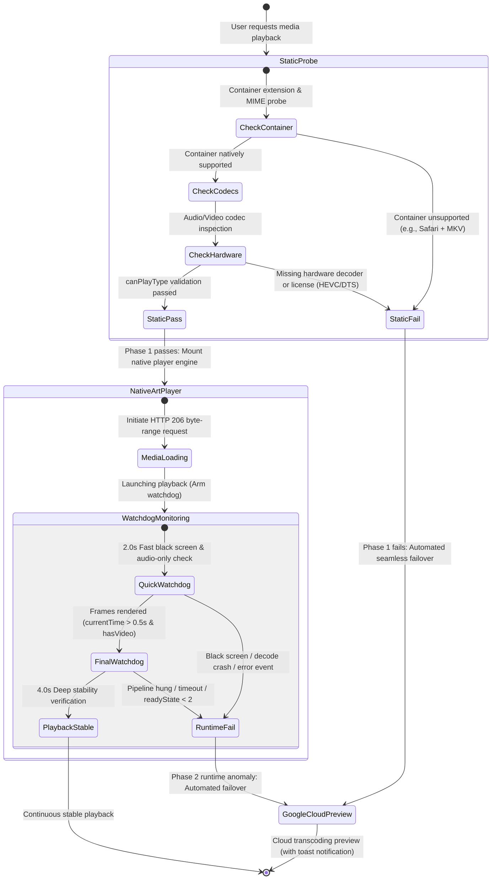

# ADR-0002: Adaptive Failover State Machine, Zero-Occlusion Viewport & Minimalist Player Architecture

  
  

  <b>English</b> · <a href="0002-adaptive-playback-sandboxing-and-minimalist-player_zh.md">简体中文</a>

---

## Status
Accepted

## Participants
- Lead: Software Architect
- Collaborators: Backend Architect, Frontend Developer, Application Security Engineer

---

## 1. Context & Problem Statement

Production feedback identified three primary architectural challenges affecting playback reliability and user experience:

1. **Manual Troubleshooting Friction During Decode Incompatibilities**:
   - When encountering media with advanced codec profiles (e.g., MKV containers on Safari, 10-bit HEVC/H.265 without OS extensions, or DTS/AC-3 proprietary audio), the previous system merely presented a yellow warning bar prompting users to manually click "Switch to Cloud Transcoding".
   - Requirement: The system must proactively detect browser decode capabilities. Upon detecting lack of support, black-screen decode errors, or watchdog timeouts, it must automatically fail over to cloud transcoding preview without manual user intervention.
2. **Visual Occlusion & Pop-Out Button Masks**:
   - Google Drive's web preview embeds a pop-out button in the top-right corner. To intercept clicks, past iterations overlaid a transparent physical `div` (`w-28 h-14`) over that area.
   - This overlay caused cursor glitches, visual artifacts, and blocked legitimate media controls in the upper viewport. The requirement demands complete elimination of all overlay cards while preventing unwanted popups.
3. **Player Window Clutter & Control Plane Noise**:
   - The top header was heavily overcrowded with miscellaneous controls: filename, quality switches, static badges, episode buttons, subtitle dropdowns, external player menus, download links, copy URL buttons, maximize, and close.
   - On mobile screens, this caused excessive line wraps. The requirement calls for a clean, minimalist 4-in-1 header containing only: Filename, External Player Menu, Maximize/Restore, and Close.

---

## 2. Architecture Decisions

### Decision 1: Dual-Phase Detection & Adaptive Failover State Machine

Establish a unified domain model dividing playback decisions into two orthogonal phases:

1. **Phase 1: Static Pre-Flight Inspection (`canBrowserPlayNatively`)**
   - Invoked before mounting the `<video>` element into the DOM.
   - Evaluates:
     - Containers known to fail browser playback (`avi`, `wmv`, `rmvb`, `vob`, `iso`), or `mkv` on Safari/WebKit;
     - Proprietary commercial audio codecs (`dts`, `truehd`, `ac3`, `eac3`, `atmos`);
     - HEVC/H.265 codec support via `canPlayType`.
   - **Adaptive Action**: If pre-flight fails, bypass native player initialization and route directly to `renderGooglePreview(item)` within milliseconds.

2. **Phase 2: Dynamic Watchdog & Runtime Auto-Fallback (`startMediaWatchdog`)**
   - If pre-flight passes but silent decode failure occurs (e.g., Chrome demuxing MKV but rendering black frames with audio):
     - **Fast Watchdog (2.0s)**: Checks `!video.paused && video.currentTime > 0.3 && !renderStatus.hasVideo`.
     - **Deep Watchdog (4.0s)**: Catches hung buffering, decode deadlocks, or `video.error`.
   - **Adaptive Action**: On failure, the watchdog destroys the native player instance, preserves playback context, routes seamlessly to Google Cloud preview, and displays a friendly toast notification.

---

### Decision 2: Zero-Occlusion Viewport Architecture

Applying defense-in-depth and progressive design:

1. **Complete Removal of Overlay Divs**:
   - The transparent overlay mask in `google-preview-container` is permanently eliminated.
   - Pointer events remain natural throughout the entire viewport, eliminating cursor jitter.
2. **Pure CSS Viewport Offset Clipping**:
   - Container uses `overflow: hidden`, while the iframe applies `top: -56px; height: calc(100% + 56px)`.
   - Shifts the 56px Google header out of visible bounds while keeping the bottom control bar and full-screen button 100% visible and responsive.
   - Restrictive iframe `sandbox` attributes are removed to prevent YouTube/Google media engines from hanging due to missing browser storage or EME permissions.
3. **CSP Defense Layer**:
   - `Content-Security-Policy: frame-src 'self' https://drive.google.com` restricts iframe embedding strictly to Google Drive.

---

### Decision 3: Minimalist 4-in-1 Header Architecture

1. **Strict 4-Core Atomic Layout**:
   - **Item 1: Filename Display (`#player-file-name`)**: Dynamic text truncation (`truncate`), native hover tooltip (`title`), and click-to-select-all (`select-all`).
   - **Item 2: External Player Dropdown (`#ext-player-dropdown-container`)**: Integrated launch protocols (MPV, PotPlayer, IINA, VLC, Infuse), with a manual toggle for cloud preview / direct streaming.
   - **Item 3: Maximize / Restore (`#player-maximize-btn`)**: Seamless full-screen viewport toggling without reloading or interrupting media playback.
   - **Item 4: Close Button (`#close-player-btn`)**: Gracefully terminates player and releases hardware decoder memory.
2. **Removal of Extraneous Visual Elements**:
   - Stripped static badges and redundant download/URL buttons from the header.
   - Episode selectors and subtitle controls are consolidated inside the internal Artplayer control bar or context menus.

---

## 3. Rejected Alternatives

| Alternative | Pros | Cons | Verdict |
| :--- | :--- | :--- | :--- |
| **Option A: Retain overlay mask, reduce size, and apply CSS `pointer-events: none`** | Simple implementation. | Clicks pass through to the pop-out button, making popup blocking reliant on brittle sandbox configs. If `pointer-events: auto` is kept, occlusion persists. | **Rejected**. Violates the zero-occlusion requirement. |
| **Option B: Force server-side FFmpeg transcoding to H.264 MP4 instead of Google Preview** | Consistent web playback experience. | Edge workers have 50ms–30s CPU limits and 128MB RAM; real-time transcoding crashes immediately. Provisioning external servers violates serverless zero-maintenance design. | **Rejected**. Google Drive Web Preview remains the most efficient, zero-cost transcoding fallback. |
| **Option C: Use modal dialogs asking users to confirm fallback** | Explicit user consent. | Adds cognitive load and interaction friction, defeating the seamless zero-effort playback objective. | **Rejected**. Replaced by automatic failover + non-intrusive toast notification + manual override option in the player menu. |

---

## 4. Consequences & Evolution Constraints

1. **Positive Outcomes**:
   - **Flawless Playback Experience**: Instant playback on any device or browser without black screens or manual troubleshooting.
   - **100% Viewport Purity**: Clean video canvas with zero overlay artifacts.
   - **Reduced Code Complexity**: Streamlined 4-element header reduces CSS overhead and layout regressions.
2. **Integration Constraints**:
   - **CI Gate Consistency**: `scripts/ci-check.js` Step 5 continuously verifies that no overlay `div` elements are reintroduced into markup.
   - **Seeking Limitation in Preview Mode**: Due to cross-origin sandboxing, progress timestamps cannot be injected into Google's embedded player, so failovers begin playback from the start.
