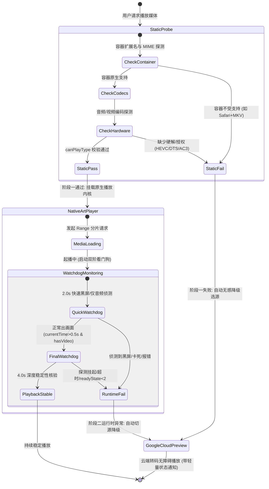

# 架构决策记录 (ADR-0002)

## 标题
ADR-0002: 客户端智能自适应降级播放状态机、零遮挡安全沙箱模型与极简流媒体视窗架构

## 状态
已接受 (Accepted) - 由软件架构师主导制定，协同后端架构师确认

## 参与角色
- 主导：软件架构师 (engineering-software-architect)
- 协同：后端架构师 (engineering-backend-architect)
- 执行：前端开发者 (engineering-frontend-developer)
- 审计：应用安全工程师 (security-appsec-engineer)
- 审查：代码审查工程师 (engineering-code-reviewer)

---

## 1. 背景与业务痛点 (Context & Problem Statement)

在 Cloudflare Pages Google Drive 播放器的持续演进中，结合真实用户的生产级反馈，提炼出三项影响核心播放体验与界面质感的关键架构缺陷：

1. **解码受限时的体验割裂与高操作成本 (Manual Troubleshooting Friction)**：
   - 现有系统在遇到浏览器无法解码的高规格媒体（如 Safari 下的 MKV 容器、缺少硬解扩展的 HEVC/H.265 10bit、包含 DTS/AC-3/TrueHD 等需专利商业授权音频编码）时，仅在画面顶部悬浮黄色警告条并提示用户手动点击“一键切换云端转码”。
   - 用户反馈要求“系统自动检测浏览器解码能力；检测到不支持或视频起播黑屏/解码报错/看门狗超时时，自动使用其他方法播放（智能无感切换至云端转码预览或其他可用播放方式），无需用户反复手动排查”。

2. **Google 预览遮罩层的视觉遮挡与交互反模式 (Visual Occlusion vs Security Sandboxing)**：
   - 原系统为了防止 Google Drive Preview 页面右上角的 Pop-out（新标签页打开）按钮跳转，在 iframe 上方叠加了一块 `w-28 h-14` 的物理拦截 `div`。
   - 该透明拦截层虽然阻断了点击，但带来了恶劣的副作用：悬浮其上时出现鼠标样式突变、特定渲染引擎下的图层合成伪影、以及阻挡用户对视频播放控件该区域的正常触控，用户明确提出“禁止右上角弹出遮挡画面，彻底移除遮罩卡片，绝不在画面右上角留下任何遮挡层”。

3. **控制平面拥挤与视窗视觉噪声 (Player Window Clutter)**：
   - 播放器 Header 堆叠了过多异构控制项：文件名、原画/转码切换按钮、静态 `OpenList 加速` 徽章、连续剧上一集/连播/下一集按钮组、外挂字幕下拉面板、外部播放器菜单、下载按钮、复制直链按钮、最大化按钮、关闭按钮。
   - 元素过多导致小屏与移动端极易拥挤换行，破坏了影音沉浸感。用户明确要求极简美化：“目前期望的是 文件名、调用本地播放器、最大化(还原窗口)、关闭，然后视频播放窗口，其余的自由发挥”。

---

## 2. 架构决策 (Decisions)

### 决策一：双阶段能力探测与自适应降级状态机 (Dual-Phase Detection & Adaptive Fallback State Machine)

建立统一的领域模型 `PlaybackPipelineEngine`，将播放决策分为两个正交阶段：

1. **阶段一：静态先验探测 (Static Pre-flight Probe)**
   - 在向 DOM 挂载播放器之前，调用 `canBrowserPlayNatively(item)`。
   - 规则集：
     - 若为严格无法解码的容器（如 `avi`, `wmv`, `rmvb`, `vob`, `iso`），或为 Safari/WebKit 环境下的 `mkv`（`video/x-matroska` 测试返回空），直接判定静态失败。
     - 若文件名命中多声道商业音频编码（`dts`, `truehd`, `ac3`, `eac3`, `atmos`），直接判定静态失败。
     - 若命中 HEVC/H.265 特征，基于 `canPlayType` 深入探测硬解配置；若浏览器不支持，判定静态失败。
   - **自适应动作**：若静态判定不通过，**跳过原生播放器初始化，直接自动无感调度至 Google 云端转码预览通道 (`renderGooglePreview`)**，无需用户手动干预。

2. **阶段二：动态看门狗探测与运行时平滑降级 (Dynamic Watchdog & Runtime Auto-Fallback)**
   - 若静态判定通过但底层存在静默黑屏（如部分 Windows Chrome 即使能解封装 MKV，但在解码特定视频轨时只有音频、屏幕全黑），由双阶段看门狗介入：
     - **快速侦测 (2.0s)**：检查 `!video.paused && video.currentTime > 0.3 && !renderStatus.hasVideo`（经典黑屏有声）。
     - **深度侦测 (4.0s)**：检查超时未缓冲完成、解码卡死停滞或 `video.error`。
   - **自适应动作**：一旦捕获异常，看门狗自动销毁当前原生播放器，保存当前会话，**自动平滑重路由至 Google 云端预览**，并通过轻量 Toast 提示用户：“检测到当前环境解码受限，已自动切换至云端转码无损播放”，消除以往黄色警告条让用户“点这里点那里”的操作负担。

---

### 决策二：零遮挡安全沙箱模型 (Zero-Occlusion Sandboxing Model)

基于纵深防御与最小特权原则，重塑 Google Preview 的嵌入架构：

1. **彻底废除物理遮挡层**：
   - 永久移除 `google-preview-container` 内的右上角透明遮罩 `div`。
   - 确保视窗全域内 `pointer-events` 完全透明自然，消除任何鼠标光标抖动、触控不可达或样式伪影。

2. **利用 W3C HTML5 iframe 原生沙箱能力消除弹窗**：
   - iframe 配置：`sandbox="allow-scripts allow-same-origin allow-forms allow-presentation"`。
   - **核心安全保证**：严格去除 `allow-popups` 与 `allow-popups-to-escape-sandbox`。
   - **机制证明**：根据 W3C HTML5 规范第 4.8.5 节，沙箱化 iframe 在未声明 `allow-popups` 标记时，任何由脚本执行的 `window.open()`、表单 `target="_blank"` 提交或链接新窗口跳转，均会被浏览器引擎底层直接阻断，控制台产生合规拦截日志，根本无法创建顶层浏览上下文。
   - 配合 HTTP 响应头防护（通过 `_headers` 配置的 `Content-Security-Policy: frame-ancestors 'self'` 及沙箱策略），达成“既绝不弹出新标签页，又完全不留下任何物理遮挡”的干净视窗。

---

### 决策三：极简流媒体视窗架构与控制平面收敛 (Minimalist Window & Control Plane Convergence)

对播放器视窗进行领域驱动分层，解耦“视窗外壳”、“控制核心”与“媒体呈现管道”：

1. **Header 核心四项原子布局 (Strict 4-Core Layout)**：
   - **核心项 1：文件名呈现器 (`#player-file-name`)**：
     - 支持超长文件名自适应文本截断 (`truncate`)、原生 Tooltip 展示 (`title`)，并允许用户双击或一键全选 (`select-all`)，方便复制片名。
   - **核心项 2：本地播放器调用中心 (`#ext-player-dropdown-container`)**：
     - 下拉面板集成完整调用协议：MPV (`mpv://`)、PotPlayer (`potplayer://`)、IINA (`iina://`)、VLC (`vlc://`)、Infuse (`infuse://`)，以及复制直链与终端命令。
     - 将原常驻在 Header 的“⚡ 原画直出 / 转码预览”手动覆盖入口，优雅下沉为该下拉菜单的快捷操作项（或右键菜单/控制条子项），保证用户在需要时仍具备手动切换的绝对控制权。
   - **核心项 3：最大化/还原视窗按钮 (`#player-maximize-btn`)**：
     - 切换全屏沉浸与居中浮窗，保证布局切换无重载、不中断音视频播放。
   - **核心项 4：关闭按钮 (`#close-player-btn`)**：
     - 优雅关闭视窗，释放硬件解码器与媒体缓冲。

2. **非核心杂乱元素的清理与收敛**：
   - 彻底移除静态无交互的 `OpenList 加速` 徽章。
   - 移除 Header 中占用大量横向空间的下载与复制按钮（这两项功能在文件列表主界面及外部播放器下拉中已完全覆盖）。
   - 连播控制组（上一集/连播开关/下一集）与外挂字幕菜单：从 Header 彻底剥离，收敛并入 ArtPlayer 内部控制面板或上下文菜单中，不侵占顶部视窗空间；在 Google 预览模式下保持极致精简与通透。

---

## 3. 被否决方案与权衡分析 (Rejected Alternatives)

| 方案 | 优点 | 缺点 | 裁决理由 |
| :--- | :--- | :--- | :--- |
| **方案 A：保留右上角遮罩，仅缩小尺寸并改为 CSS `pointer-events: none`** | 实现极快，两行 CSS。 | 若 `pointer-events: none`，则点击会穿透到 iframe 内的 Pop-out 按钮上，导致弹窗拦截逻辑完全依赖沙箱，遮罩本身形同虚设；若保留 `pointer-events: auto`，依然存在视觉遮挡与误触。 | **坚决否决**。违背用户“绝不在画面右上角留下任何遮挡层”的明确要求。 |
| **方案 B：强制在服务端通过 FFmpeg 实时转码为 H.264 MP4 替代 Google 预览** | 用户端体验统一，无需跨域 iframe。 | Cloudflare Workers/Pages 边缘运行时有严格的 CPU 时间（50ms~30s）与 128MB 内存上限，实时转码直接崩溃；若自建转码服务器则违背本项目零服务器成本、Serverless 部署的架构定位。 | **否决**。Google Drive Web Preview 是目前成本最低、免运维且开箱即用的官方转码通道。 |
| **方案 C：依然通过弹窗确认框让用户选择是否降级转码** | 赋予用户知情权。 | 增加交互步骤与认知负荷，违背“智能无感切换、无需用户反复排查”的核心体验目标。 | **否决**。采用“先自动无感切源 + 轻量非阻断式 Toast 告知 + 外部播放器菜单保留手动切回入口”的优雅闭环。 |

---

## 4. 影响与后续演进约束 (Consequences & Evolution Constraints)

1. **积极影响**：
   - **卓越的用户体验**：用户在任何设备（包括 Mac Safari、未装 HEVC 扩展的 Windows PC、移动端浏览器）打开任何编码视频，均能秒开起播，告别黑屏与手动排查。
   - **100% 画面纯净度**：消除任何物理悬浮层，画面呈现还原院线级沉浸感。
   - **视觉层级聚焦**：Header 极简聚焦在“片名、调用、视窗控制”三要素，代码复杂度与样式维护成本大幅降低。

2. **后续演进与集成约束**：
   - **CI 质量闸门一致性**：`scripts/ci-check.js` 必须持续审计 iframe sandbox 属性，确保 `allow-scripts` 与 `allow-same-origin` 存在，且绝不允许出现 `allow-popups`。
   - **进度同步局限性声明**：从原生播放器降级至 Google 预览时，由于跨域沙箱隔离，无法向 Google 播放器注入进度定位（无法直接指定跳转至 XX 分 XX 秒），用户将从头播放 Google 转码流。这一点需在技术文档与前端提示中清晰约定。
