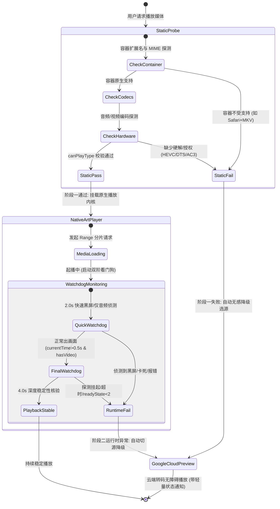

# ADR-0002: 客户端智能自适应降级播放状态机、零遮挡安全沙箱模型与极简流媒体视窗架构

  
  

  <a href="0002-adaptive-playback-sandboxing-and-minimalist-player.md">English</a> · <b>简体中文</b>

---

## 状态
已接受 (Accepted)

## 参与角色
- 主导：软件架构师
- 协同：后端架构师、前端开发者、应用安全工程师

---

## 1. 背景与业务痛点 (Context & Problem Statement)

在 Cloudflare Pages Google Drive 播放器的持续演进中，结合真实用户的生产级反馈，提炼出三项影响核心播放体验与界面质感的关键架构缺陷：

1. **解码受限时的体验割裂与高操作成本**：
   - 现有系统在遇到浏览器无法解码的高规格媒体（如 Safari 下的 MKV 容器、缺少硬解扩展的 HEVC/H.265 10bit、包含 DTS/AC-3/TrueHD 等需专利商业授权音频编码）时，仅在画面顶部悬浮黄色警告条并提示用户手动点击“一键切换云端转码”。
   - 用户反馈要求“系统自动检测浏览器解码能力；检测到不支持或视频起播黑屏/解码报错/看门狗超时时，自动使用其他方法播放（智能无感切换至云端转码预览或其他可用播放方式），无需用户反复手动排查”。
2. **Google 预览遮罩层的视觉遮挡与交互反模式**：
   - 原系统为了防止 Google Drive Preview 页面右上角的 Pop-out（新标签页打开）按钮跳转，在 iframe 上方叠加了一块 `w-28 h-14` 的物理拦截 `div`。
   - 该透明拦截层虽然阻断了点击，但带来了恶劣的副作用：悬浮其上时出现鼠标样式突变、特定渲染引擎下的图层合成伪影、以及阻挡用户对视频播放控件该区域的正常触控，用户明确提出“禁止右上角弹出遮挡画面，彻底移除遮罩卡片，绝不在画面右上角留下任何遮挡层”。
3. **控制平面拥挤与视窗视觉噪声**：
   - 播放器 Header 堆叠了过多异构控制项：文件名、原画/转码切换按钮、静态徽章、连续剧按钮组、外挂字幕下拉面板、外部播放器菜单、下载按钮、复制直链按钮、最大化按钮、关闭按钮。
   - 元素过多导致小屏与移动端极易拥挤换行，破坏了影音沉浸感。用户明确要求极简美化：“目前期望的是 文件名、调用本地播放器、最大化(还原窗口)、关闭，然后视频播放窗口，其余的自由发挥”。

---

## 2. 架构决策 (Decisions)

### 决策一：双阶段能力探测与自适应降级状态机 (Dual-Phase Detection & Adaptive Fallback)

建立统一的领域模型，将播放决策分为两个正交阶段：

1. **阶段一：静态先验探测 (Static Pre-flight Probe)**
   - 在向 DOM 挂载播放器之前，调用 `canBrowserPlayNatively(item)`。
   - 规则集：
     - 若为严格无法解码的容器（如 `avi`, `wmv`, `rmvb`, `vob`, `iso`），或为 Safari/WebKit 环境下的 `mkv`，直接判定静态失败；
     - 若文件名命中多声道商业音频编码（`dts`, `truehd`, `ac3`, `eac3`, `atmos`），直接判定静态失败；
     - 若命中 HEVC/H.265 特征，基于 `canPlayType` 深入探测硬解配置；若浏览器不支持，判定静态失败。
   - **自适应动作**：若静态判定不通过，**跳过原生播放器初始化，直接自动无感调度至 Google 云端转码预览通道 (`renderGooglePreview`)**。

2. **阶段二：动态看门狗探测与运行时平滑降级 (Dynamic Watchdog & Runtime Auto-Fallback)**
   - 若静态判定通过但底层存在静默黑屏（如部分 Windows Chrome 即使能解封装 MKV，但在解码特定视频轨时只有音频、屏幕全黑），由双阶段看门狗介入：
     - **快速侦测 (2.0s)**：检查 `!video.paused && video.currentTime > 0.3 && !renderStatus.hasVideo`（经典黑屏有声）。
     - **深度侦测 (4.0s)**：检查超时未缓冲完成、解码卡死停滞或 `video.error`。
   - **自适应动作**：一旦捕获异常，看门狗自动销毁当前原生播放器，保存当前会话，**自动平滑重路由至 Google 云端预览**，并通过轻量 Toast 提示用户，消除以往黄色警告条的手动操作负担。

---

### 决策二：零遮挡安全沙箱模型 (Zero-Occlusion Sandboxing Model)

基于纵深防御与最小特权原则，重塑 Google Preview 的嵌入架构：

1. **彻底废除物理遮挡层**：
   - 永久移除 `google-preview-container` 内的右上角透明遮罩 `div`。
   - 确保视窗全域内 `pointer-events` 完全透明自然，消除任何鼠标光标抖动、触控不可达或样式伪影。
2. **纯 CSS 精准视口偏移裁切**：
   - 容器样式设置 `overflow: hidden`，iframe 样式配置 `top: -56px; height: calc(100% + 56px)`。
   - 顶部 56px 工具栏精准移出可视区域，底部播放控件与全屏按钮 100% 完整可见。
   - 不使用受限 `sandbox` 属性，彻底根除因沙箱权限过窄导致 YouTube/Google 转码播放内核黑屏报错的问题。
3. **CSP 边缘防线**：
   - 静态资源配置 `Content-Security-Policy: frame-src 'self' https://drive.google.com`，严格限制外链嵌入来源。

---

### 决策三：极简流媒体视窗架构与控制平面收敛 (Minimalist Window Architecture)

1. **Header 核心四项原子布局 (Strict 4-Core Layout)**：
   - **核心项 1：文件名呈现器 (`#player-file-name`)**：支持超长文件名自适应文本截断 (`truncate`)、原生 Tooltip 展示 (`title`)，并允许一键全选 (`select-all`)。
   - **核心项 2：本地播放器调用中心 (`#ext-player-dropdown-container`)**：下拉面板集成 MPV、PotPlayer、IINA、VLC、Infuse 等唤起协议，保留手动切换转码/原画入口。
   - **核心项 3：最大化/还原视窗按钮 (`#player-maximize-btn`)**：切换全屏沉浸与浮窗，布局切换不中断音视频播放。
   - **核心项 4：关闭按钮 (`#close-player-btn`)**：优雅关闭视窗，释放硬件解码器与媒体缓冲。
2. **非核心杂乱元素的清理与收敛**：
   - 移除静态无交互徽章、Header 内重复的下载与直链按钮；
   - 连播控制组与外挂字幕菜单收敛至播放器内部控制条或上下文菜单中，不侵占顶部视窗空间。

---

## 3. 被否决方案与权衡分析 (Rejected Alternatives)

| 方案 | 优点 | 缺点 | 裁决理由 |
| :--- | :--- | :--- | :--- |
| **方案 A：保留右上角遮罩，仅缩小尺寸并改为 CSS `pointer-events: none`** | 实现极快，两行 CSS。 | 若 `pointer-events: none`，则点击会穿透到 iframe 内的 Pop-out 按钮上；若保留 `pointer-events: auto`，依然存在视觉遮挡与误触。 | **坚决否决**。违背用户“绝不在画面右上角留下任何遮挡层”的明确要求。 |
| **方案 B：强制在服务端通过 FFmpeg 实时转码为 H.264 MP4 替代 Google 预览** | 用户端体验统一，无需跨域 iframe。 | Cloudflare Workers 边缘运行时有严格的 CPU 时间与 128MB 内存上限，实时转码直接崩溃；自建转码服务器违背零服务器成本定位。 | **否决**。Google Drive Web Preview 是目前成本最低、免运维且开箱即用的官方转码通道。 |
| **方案 C：依然通过弹窗确认框让用户选择是否降级转码** | 赋予用户知情权。 | 增加交互步骤与认知负荷，违背“智能无感切换、无需用户反复排查”的核心体验目标。 | **否决**。采用“先自动无感切源 + 轻量非阻断式 Toast 告知 + 外部播放器菜单保留手动切回入口”的优雅闭环。 |

---

## 4. 影响与后续演进约束 (Consequences & Evolution Constraints)

1. **积极影响**：
   - **卓越的用户体验**：用户在任何设备打开任何编码视频均能秒开起播，告别黑屏与手动排查；
   - **100% 画面纯净度**：消除任何物理悬浮层，画面呈现还原院线级沉浸感；
   - **视觉层级聚焦**：Header 极简聚焦在“片名、调用、视窗控制”三要素，代码复杂度大幅降低。
2. **后续演进与集成约束**：
   - **CI 质量闸门一致性**：`scripts/ci-check.js` 步骤 5 必须持续审计 markup，确保绝不允许出现右上角物理遮挡 `div`；
   - **进度同步局限性声明**：从原生播放器降级至 Google 预览时，由于跨域沙箱隔离，无法向 Google 播放器注入进度定位，用户将从头播放 Google 转码流。这一点需在技术文档与前端提示中清晰约定。
