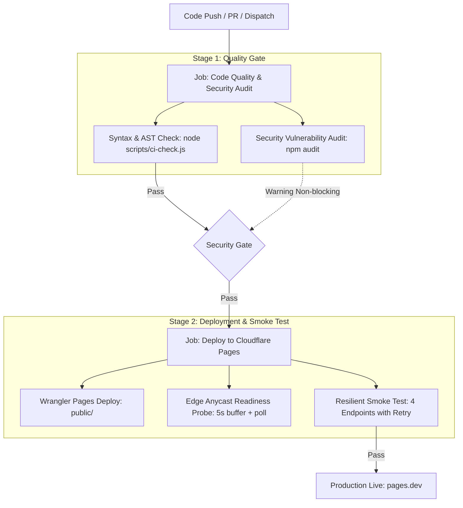

# Cloudflare Pages CI/CD 流水线与部署运维指南 (Deployment & Troubleshooting)

本文档面向运维工程师与开发者，详细阐述基于 GitHub Actions 与 Cloudflare Pages 的自动化持续集成与交付 (CI/CD) 架构、环境变量/密钥配置规范、冒烟测试机制以及常见构建故障的排查手册。

---

## 目录
- [1. 流水线架构与阶段设计](#1-流水线架构与阶段设计)
  - [阶段 1：质量与安全门禁 (Code Quality & Security Audit)](#阶段-1质量与安全门禁-code-quality--security-audit)
  - [阶段 2：Cloudflare Pages 部署与冒烟测试 (Deploy to Cloudflare Pages)](#阶段-2cloudflare-pages-部署与冒烟测试-deploy-to-cloudflare-pages)
- [2. 部署凭据与 GitHub Secrets 配置](#2-部署凭据与-github-secrets-配置)
  - [必备 GitHub Actions Secrets](#必备-github-actions-secrets)
  - [Cloudflare Pages 生产环境变量配置](#cloudflare-pages-生产环境变量配置)
- [3. 边缘路由隔离与性能优化原理 (`_routes.json`)](#3-边缘路由隔离与性能优化原理-_routesjson)
- [4. 冒烟测试与边缘预热机制 (`healthcheck.js`)](#4-冒烟测试与边缘预热机制-healthcheckjs)
- [5. 故障排查手册 (Troubleshooting Guide)](#5-故障排查手册-troubleshooting-guide)
  - [案例 A：GitHub Actions 冒烟测试报 HTTP 500 (Run 39524993381 典型案例)](#案例-agithub-actions-冒烟测试报-http-500-run-39524993381-典型案例)
  - [案例 B：Wrangler 部署报 Authentication error (10000)](#案例-bwrangler-部署报-authentication-error-10000)
  - [案例 C：页面提示“未检测到服务账号凭据”](#案例-c页面提示未检测到服务账号凭据)
  - [案例 D：Google Drive 报 403 `The user does not have sufficient permissions`](#案例-dgoogle-drive-报-403-the-user-does-not-have-sufficient-permissions)

---

## 1. 流水线架构与阶段设计

流水线定义文件位于 `.github/workflows/ci-cd.yml`，划分为严密的双阶段质量闸门：



### 阶段 1：质量与安全门禁 (Code Quality & Security Audit)
- **代码静态与语法校验** (`npm run test:syntax` -> `node scripts/ci-check.js`)：
  - 递归扫描 `functions/` 与 `public/js/` 下所有 JavaScript 文件，使用 `node --check` 进行原生 AST 解析，确保无语法与语法树损坏。
  - 检查静态文件依赖完整性（必须存在 `index.html`、`style.css`、`app.js`、`favicon.svg`、`_routes.json`、`_headers`）。
  - 校验 `wrangler.toml` 配置文件有效性。
- **依赖安全漏洞审计** (`npm audit --audit-level=high`)：
  - 检测生产与开发依赖漏洞，保障供应链安全。

### 阶段 2：Cloudflare Pages 部署与冒烟测试 (Deploy to Cloudflare Pages)
- **Wrangler Pages 发布** (`cloudflare/wrangler-action@v3`)：
  - 上传 `public` 静态资源目录并编译打包 `functions` 边缘 Worker。
  - 分支规则：`main` 分支发布至生产环境 (`--branch=main`)，其他分支发布为独立预览环境（Preview URL）。
- **边缘预热与自适应冒烟测试** (`node scripts/healthcheck.js`)：
  - 具备 5 秒基础边缘广播缓冲 + `waitForEdgeReadiness` 预热轮询。
  - 对 4 个核心端点执行指数退避重试探测（1.5s -> 2.25s -> 3.37s）：
    1. `GET /`：首页 HTML 渲染与 Content-Type (`text/html`) 验证。
    2. `GET /css/style.css`：样式表静态 CDN 直通与 Content-Type (`text/css`) 验证。
    3. `GET /api/info`：Functions 边缘计算与配置接口 JSON 响应。
    4. `OPTIONS /api/stream/test-probe`：媒体流 CORS 跨域预检与允许标头。

---

## 2. 部署凭据与 GitHub Secrets 配置

### 必备 GitHub Actions Secrets
前往 GitHub 仓库 -> **Settings** -> **Secrets and variables** -> **Actions** -> **Repository secrets** 添加：

| Secret 键名 | 说明 | 获取方式 |
| :--- | :--- | :--- |
| `CLOUDFLARE_API_TOKEN` | 具有 Cloudflare Pages 管理权限的 API 令牌 | Cloudflare Dashboard -> **My Profile** -> **API Tokens** -> **Create Token** -> 选择模板 **Edit Cloudflare Workers**，权限确保包含 `Account -> Cloudflare Pages -> Edit` |
| `CLOUDFLARE_ACCOUNT_ID` | Cloudflare 账户 ID | Cloudflare Dashboard 任意域名概览页或 Workers & Pages 首页右侧侧边栏中的 **Account ID** (32位十六进制字符串) |

### Cloudflare Pages 生产环境变量配置
进入 Cloudflare Dashboard -> **Workers & Pages** -> 选择 `cf-pages-drive-player` 项目 -> **Settings** -> **Environment variables**：

| 变量名 | 类型 | 说明 |
| :--- | :---: | :--- |
| `SERVICE_ACCOUNT_JSON` | **Secret** (加密文本) | Google Cloud 下载的服务账号私钥 JSON 文本（原样完整粘贴） |
| `ROOT_FOLDER_ID` | 纯文本 | 挂载的总文件夹 ID（从 Google Drive 地址栏获取） |
| `SITE_NAME` | 纯文本 (选填) | 自定义站点名称（如 `我的影视库`） |

---

## 3. 边缘路由隔离与性能优化原理 (`_routes.json`)

在 `public/_routes.json` 中配置了明确的路由分离规则：
```json
{
  "version": 1,
  "include": [
    "/api/*"
  ],
  "exclude": []
}
```

### 为什么该配置至关重要？
1. **防止 Worker 冷启动拖垮静态资源**：
   若不限制，Cloudflare Pages 会默认让所有请求（包括 `/`、`/css/style.css`、图片等）经过 Functions 处理。在部署初期的 DNS 收敛期，Worker 冷启动可能导致静态请求出现 500 错误。
2. **极速 CDN 直通**：
   通过 `include: ["/api/*"]`，浏览器请求 `/` 与 `/css/style.css` 时直接由 Cloudflare 离用户最近的 Anycast 边缘缓存节点响应，首字节时间 (TTFB) 降至 20ms 以内，且不消耗 Worker 每日免费请求额度。
3. **架构职责解耦**：
   全局中间件下沉至 `functions/api/_middleware.js`，严格只对 `/api/*` 生效。

---

## 4. 冒烟测试与边缘预热机制 (`healthcheck.js`)

在本地或 CI 中可随时执行冒烟测试：
```bash
# 本地测试已部署实例
node scripts/healthcheck.js "https://cf-pages-drive-player.pages.dev"

# 无参数运行时输出端点契约说明
node scripts/healthcheck.js
```

### 冒烟测试验证矩阵：
| 探测端点 | 方法 | 期望状态码 | 校验逻辑 |
| :--- | :---: | :---: | :--- |
| `/` | `GET` | 200 | `Content-Type` 必须包含 `text/html` |
| `/css/style.css` | `GET` | 200 | `Content-Type` 必须包含 `text/css` |
| `/api/info` | `GET` | 200 | JSON 正文必须解析且包含布尔类型 `success` |
| `/api/stream/test-probe` | `OPTIONS` | 204 / 200 | 标头 `Access-Control-Allow-Origin` 必须为 `*` |

---

## 5. 故障排查手册 (Troubleshooting Guide)

### 案例 A：GitHub Actions 冒烟测试报 HTTP 500 (Run 39524993381 典型案例)
- **现象**：
  流水线部署步骤成功，但在 `Post-deploy Smoke Test / Healthcheck` 出现：
  ```text
  ❌ [FAIL] 首页静态资源状态 (GET /) -> HTTP 500 (校验未通过)
  ❌ [FAIL] 样式表完整性 (GET /css/style.css) -> HTTP 500 (校验未通过)
  ✅ [PASS] 系统凭证与站点信息接口 (GET /api/info) -> HTTP 200
  ```
- **根本原因**：
  1. 根目录下存在全局中间件 `functions/_middleware.js`，拦截了所有静态资源请求。
  2. 部署完成后 Cloudflare 控制面完成并不代表全球边缘 Anycast 节点的数据面资产分发已全部完成（存在 2~5 秒微小同步时差）。
  3. 旧冒烟测试属于单次刚性请求，一旦命中尚未完全收敛的边缘节点即刻判定失败。
- **根治措施**：
  1. 将中间件移至 `functions/api/_middleware.js`。
  2. 在 `public/_routes.json` 声明 `include: ["/api/*"]`。
  3. 冒烟测试引入预热机制与指数退避重试（最多重试 4 次）。

---

### 案例 B：Wrangler 部署报 Authentication error (10000)
- **现象**：
  `Deploy to Cloudflare Pages` 步骤报 `Authentication error [code: 10000]`。
- **排查步骤**：
  1. 检查 GitHub 仓库 Secrets 中 `CLOUDFLARE_API_TOKEN` 是否被意外撤销或过期。
  2. 确认 Token 权限包含 `Cloudflare Pages: Edit`。
  3. 检查 `CLOUDFLARE_ACCOUNT_ID` 是否与 API Token 所属账户严格一致。

---

### 案例 C：页面提示“未检测到服务账号凭据”
- **现象**：
  打开网页弹出黄色提示，或者 `/api/info` 返回 `configured: false`。
- **排查步骤**：
  1. 登录 Cloudflare Pages 控制台 -> Settings -> Environment variables -> 查看 `Production` 环境下是否存在 `SERVICE_ACCOUNT_JSON`。
  2. 确认粘贴的 JSON 内容没有被截断（开头为 `{"type": "service_account"...}`）。
  3. **重要**：环境变量修改后，必须点击最近一次部署右侧的 **Retry deployment (重新部署)**，环境变量才能注入当前运行容器。

---

### 案例 D：Google Drive 报 403 `The user does not have sufficient permissions`
- **现象**：
  点击播放或列出文件时提示 403 权限不足。
- **排查步骤**：
  1. 打开服务账号 JSON，复制其中的 `client_email` 地址。
  2. 在 Google Drive 网页端找到挂载的总文件夹，点击「共享」。
  3. 将该邮箱添加为「查看者 (Viewer)」或「内容管理员 (Content Manager)」。
