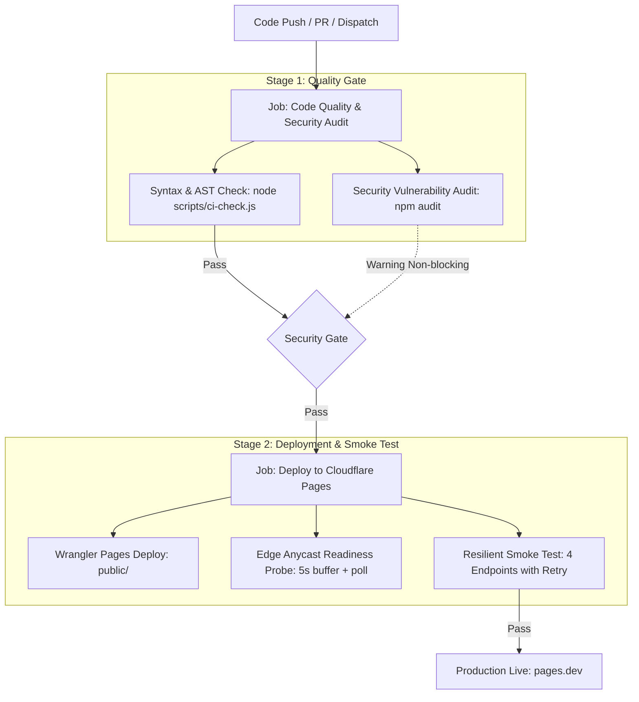

<div align="center">

# Cloudflare Pages CI/CD Pipeline & Deployment Guide

<p align="center">
  <a href="https://github.com/features/actions"></a>
  <a href="https://pages.cloudflare.com/"></a>
  
</p>

<p align="center">
  <b>English</b> · <a href="ci-cd-deployment-guide_zh.md">简体中文</a>
</p>

</div>

---

This guide provides DevOps engineers and developers with a comprehensive reference for automated continuous integration and delivery (CI/CD) with GitHub Actions and Cloudflare Pages. It covers pipeline architecture, secrets configuration, Anycast edge smoke testing, and an incident troubleshooting runbook.

---

## 📑 Table of Contents

- [1. Pipeline Architecture & Stage Design](#1-pipeline-architecture--stage-design)
  - [Stage 1: Code Quality & Security Audit](#stage-1-code-quality--security-audit)
  - [Stage 2: Cloudflare Pages Deployment & Smoke Testing](#stage-2-cloudflare-pages-deployment--smoke-testing)
- [2. Deployment Credentials & GitHub Secrets](#2-deployment-credentials--github-secrets)
  - [Required GitHub Actions Secrets](#required-github-actions-secrets)
  - [Cloudflare Pages Production Environment Variables](#cloudflare-pages-production-environment-variables)
- [3. Edge Routing Isolation & Performance (`_routes.json`)](#3-edge-routing-isolation--performance-_routesjson)
- [4. Smoke Testing & Edge Warmup Mechanism (`healthcheck.js`)](#4-smoke-testing--edge-warmup-mechanism-healthcheckjs)
- [5. Troubleshooting Guide](#5-troubleshooting-guide)
  - [Case A: Post-Deploy Smoke Test Reports HTTP 500](#case-a-post-deploy-smoke-test-reports-http-500)
  - [Case B: Wrangler Deployment Authentication Error (10000)](#case-b-wrangler-deployment-authentication-error-10000)
  - [Case C: "Missing Service Account Credentials" on Page Load](#case-c-missing-service-account-credentials-on-page-load)
  - [Case D: Google Drive 403 "The user does not have sufficient permissions"](#case-d-google-drive-403-the-user-does-not-have-sufficient-permissions)

---

## 1. Pipeline Architecture & Stage Design

The workflow definition resides in `.github/workflows/ci-cd.yml`, structured as a strict dual-stage quality gate:



### Stage 1: Code Quality & Security Audit
- **Static Syntax & Contract Gate** (`npm run test:syntax` -> `node scripts/ci-check.js`):
  - **Step 1/7**: Recursively scans all JavaScript files in `functions/` and `public/js/` via Node.js native AST parsing to eliminate syntax defects.
  - **Step 2/7**: Validates presence and integrity of static dependencies (`index.html`, `style.css`, `app.js`, `favicon.svg`, `_routes.json`, `_headers`) and routing isolation rules.
  - **Step 3/7**: Verifies `wrangler.toml` configuration syntax and build output paths.
  - **Step 4/7**: Verifies streaming media contracts (MKV `video/x-matroska` MIME normalization, `Accept-Ranges: bytes`, and `Content-Range` HTTP 206 passthrough).
  - **Step 5/7**: Verifies Google preview zero-occlusion security sandbox constraints (anti-regression: no overlay masks; iframe sandboxing strictly excludes `allow-popups` and `allow-top-navigation`).
  - **Step 6/7**: Verifies client dual-phase adaptive playback fallback and smart source selection contracts.
  - **Step 7/7**: Verifies minimalist 4-in-1 player header structure and security response headers (CSP whitelisting `drive.google.com` and `nosniff`).
- **Dependency Vulnerability Audit** (`npm audit --omit=dev --audit-level=high`):
  - Enforces zero high-severity production runtime vulnerabilities while issuing warnings for dev toolchain dependencies.

### Stage 2: Cloudflare Pages Deployment & Smoke Testing
- **Wrangler Pages Deployment** (`cloudflare/wrangler-action@v3`):
  - Uploads the `public` static directory and compiles `functions` edge workers.
  - Deploys `main` branch to production (`--branch=main`) and other branches to preview environments with distinct preview URLs.
- **Edge Warmup & Resilient Smoke Test** (`node scripts/healthcheck.js`):
  - Incorporates a 15-second Anycast edge propagation buffer with `waitForEdgeReadiness` polling.
  - Probes 8 critical endpoints with exponential backoff retries (1.5s -> 2.25s -> 3.37s):
    1. `GET /`: Validates root HTML status and `text/html` Content-Type.
    2. `GET /`: Validates security headers (`X-Content-Type-Options: nosniff`).
    3. `GET /`: Validates CSP compliance (allowing `drive.google.com`).
    4. `GET /css/style.css`: Confirms direct CDN stylesheet delivery (`text/css`).
    5. `GET /js/app.js`: Validates application JavaScript delivery (`application/javascript`).
    6. `GET /api/info`: Tests Functions edge runtime and JSON response.
    7. `GET /api/list`: Verifies directory indexing contract and item payloads.
    8. `OPTIONS /api/stream/test-probe`: Tests CORS pre-flight headers and exposure.

---

## 2. Deployment Credentials & GitHub Secrets

### Required GitHub Actions Secrets
In your GitHub repository, navigate to **Settings** -> **Secrets and variables** -> **Actions** -> **Repository secrets** and configure:

| Secret Name | Description | Source |
| :--- | :--- | :--- |
| `CLOUDFLARE_API_TOKEN` | API Token with Cloudflare Pages Edit permissions | Cloudflare Dashboard -> **My Profile** -> **API Tokens** -> **Create Token** -> Use template **Edit Cloudflare Workers**, ensuring `Account -> Cloudflare Pages -> Edit` is granted |
| `CLOUDFLARE_ACCOUNT_ID` | Cloudflare Account ID | Available in the right sidebar of Cloudflare Dashboard Workers & Pages overview (32-character hexadecimal string) |

### Cloudflare Pages Production Environment Variables
In Cloudflare Dashboard, go to **Workers & Pages** -> select your `cf-pages-drive-player` project -> **Settings** -> **Environment variables**:

| Variable | Type | Description |
| :--- | :---: | :--- |
| `SERVICE_ACCOUNT_JSON` | **Secret** (Encrypted) | Full Google Cloud service account JSON private key content |
| `ROOT_FOLDER_ID` | Plain text | Mounted Google Drive folder ID (extracted from browser address bar) |
| `SITE_NAME` | Plain text (Optional) | Custom site title (e.g., `My Media Vault`) |
| `SITE_SUBTITLE` | Plain text (Optional) | Custom subtitle or tagline |

---

## 3. Edge Routing Isolation & Performance (`_routes.json`)

`public/_routes.json` defines explicit routing boundaries:
```json
{
  "version": 1,
  "include": [
    "/api/*"
  ],
  "exclude": []
}
```

### Why This Configuration Is Essential
1. **Prevents Worker Cold Starts from Impacting Static Assets**:
   Without explicit routing rules, Cloudflare Pages defaults to routing every request (including `/`, `/css/style.css`, and images) through Functions. During edge DNS convergence, worker cold starts can cause transient 500 errors on static assets.
2. **Direct Anycast CDN Delivery**:
   With `include: ["/api/*"]`, requests for `/` and static assets bypass the Functions compute layer entirely, served directly from Cloudflare's nearest edge caches with sub-20ms TTFB. This also conserves daily Worker request quotas.
3. **Decoupled Architecture**:
   Global middleware is confined to `functions/api/_middleware.js`, strictly executing on API routes.

---

## 4. Smoke Testing & Edge Warmup Mechanism (`healthcheck.js`)

You can execute the automated smoke test locally or within CI:
```bash
# Test against a deployed instance
node scripts/healthcheck.js "https://cf-pages-drive-player.pages.dev"

# Run without arguments to display endpoint contract documentation
node scripts/healthcheck.js
```

### Smoke Test Validation Matrix:
| Endpoint | Method | Expected Status | Validation Logic |
| :--- | :---: | :---: | :--- |
| `/` | `GET` | 200 | `Content-Type` must contain `text/html` |
| `/css/style.css` | `GET` | 200 | `Content-Type` must contain `text/css` |
| `/api/info` | `GET` | 200 | JSON body must parse and contain boolean `success` |
| `/api/stream/test-probe` | `OPTIONS` | 204 / 200 | Header `Access-Control-Allow-Origin` must equal `*` |

---

## 5. Troubleshooting Guide

### Case A: Post-Deploy Smoke Test Reports HTTP 500
- **Symptoms**:
  Deployment finishes with exit code 0, but `Post-deploy Smoke Test / Healthcheck` fails:
  ```text
  ❌ [FAIL] Root HTML status (GET /) -> HTTP 500 (Check failed)
  ❌ [FAIL] Stylesheet integrity (GET /css/style.css) -> HTTP 500 (Check failed)
  ✅ [PASS] System credentials & site info (GET /api/info) -> HTTP 200
  ```
- **Root Cause**:
  1. A root-level middleware `functions/_middleware.js` was intercepting static files;
  2. Cloudflare control plane deployment completion precedes global edge Anycast data plane propagation by 2–5 seconds;
  3. Rigid single-request health checks fail if querying an edge node still converging.
- **Remediation**:
  1. Move middleware to `functions/api/_middleware.js`;
  2. Maintain `include: ["/api/*"]` in `public/_routes.json`;
  3. Use exponential backoff retries (up to 4 attempts) in the healthcheck script. See [ADR-001](adr/ADR-001-cf-pages-edge-routing-and-ci-resilience.md) for architectural design details.

---

### Case B: Wrangler Deployment Authentication Error (10000)
- **Symptoms**:
  The `Deploy to Cloudflare Pages` step exits with `Authentication error [code: 10000]`.
- **Troubleshooting Steps**:
  1. Check whether `CLOUDFLARE_API_TOKEN` in GitHub Secrets has expired or been revoked;
  2. Ensure the token has `Cloudflare Pages: Edit` permissions;
  3. Confirm `CLOUDFLARE_ACCOUNT_ID` matches the account that owns the API token.

---

### Case C: "Missing Service Account Credentials" on Page Load
- **Symptoms**:
  A yellow warning banner appears on the web page, or `/api/info` returns `configured: false`.
- **Troubleshooting Steps**:
  1. In Cloudflare Pages Dashboard -> Settings -> Environment variables, verify `SERVICE_ACCOUNT_JSON` exists in the `Production` environment;
  2. Verify the pasted JSON is complete (starts with `{"type": "service_account"...}`);
  3. **Important**: After adding or editing environment variables, click **Retry deployment** on the latest build to re-bake variables into the active container.

---

### Case D: Google Drive 403 "The user does not have sufficient permissions"
- **Symptoms**:
  Listing files or starting streams yields 403 Forbidden.
- **Troubleshooting Steps**:
  1. Open your service account JSON and copy `client_email`;
  2. Open Google Drive in your browser, locate your mounted root folder, and click "Share";
  3. Add `client_email` as **Viewer** (for read-only) or **Content Manager / Editor** (for file modifications).
