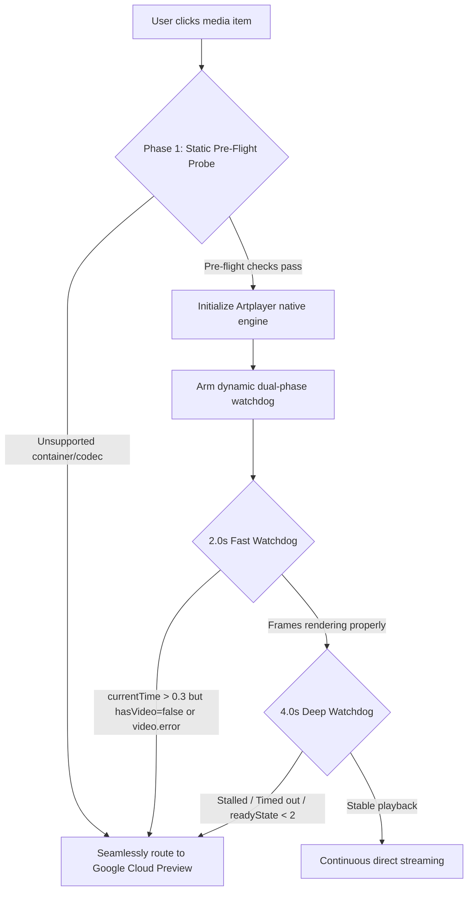

<div align="center">

# Player Architecture, Adaptive Failover State Machine & User Guide

<p align="center">
  
  
  
</p>

<p align="center">
  <b>English</b> · <a href="player-architecture-and-user-guide_zh.md">简体中文</a>
</p>

</div>

---

This document provides full-stack engineers, frontend developers, and power users with in-depth technical implementation details and user guidance for Cloudflare Drive Player. It covers media decode compatibility detection, zero-occlusion viewport geometry, and minimalist player window architecture.

---

## 📑 Table of Contents

- [1. Background & Core Design Objectives](#1-background--core-design-objectives)
- [2. Core Architecture & Technical Implementation](#2-core-architecture--technical-implementation)
  - [2.1 Dual-Phase Adaptive Failover State Machine](#21-dual-phase-adaptive-failover-state-machine)
  - [2.2 Zero-Occlusion Pure Viewport Architecture](#22-zero-occlusion-pure-viewport-architecture)
  - [2.3 Minimalist 4-in-1 Header Architecture](#23-minimalist-4-in-1-header-architecture)
- [3. External Player Launch Protocols (URL Schemes)](#3-external-player-launch-protocols-url-schemes)
- [4. Browser Decode Compatibility & Source Routing Matrix](#4-browser-decode-compatibility--source-routing-matrix)
- [5. Quality Assurance & Developer Debugging Guide](#5-quality-assurance--developer-debugging-guide)

---

## 1. Background & Core Design Objectives

When streaming media directly from Google Drive inside web browsers, users and developers face three critical obstacles:

1. **Heterogeneous Decode Capabilities & Manual Troubleshooting Friction**:
   - Media libraries often contain MKV containers, HEVC/H.265 10-bit HDR video, or commercial multi-channel audio tracks (DTS, AC-3, TrueHD). Browser environments vary wildly: Safari rejects MKV containers outright; Windows Chrome without HEVC extensions plays audio while remaining stuck on a black screen. Historically, players showed warning banners requiring users to manually select cloud transcoding.
   - **Objective**: **Fully automated seamless failover**. The frontend proactively inspects media formats and runtime decode states; if unsupported or stalled, it automatically switches to Google Cloud transcoding preview without user intervention.
2. **Google Preview Pop-Out Icons & Overlay Mask Artifacts**:
   - Google Drive's embedded preview includes a pop-out button in the top-right corner. Past workarounds placed a transparent or translucent overlay `div` over that corner to block clicks, which caused cursor flickering, visual distortion, and blocked legitimate media controls.
   - **Objective**: **Completely eliminate physical overlay masks** while using CSS margin offset clipping and CSP headers to invisibly neutralize unwanted popups.
3. **Player Window Clutter & Visual Noise**:
   - Cluttered headers filled with episode selectors, subtitle panels, download links, and direct stream URLs cause awkward text wrapping on mobile devices.
   - **Objective**: **Strict 4-in-1 Minimalist Header**: Focus exclusively on (1) Filename (with auto-truncation and select-all), (2) External Player Launcher, (3) Maximize/Restore, and (4) Close, presenting an expansive media canvas.

---

## 2. Core Architecture & Technical Implementation

### 2.1 Dual-Phase Adaptive Failover State Machine

The playback pipeline implements a closed-loop system combining pre-flight inspection with runtime watchdog monitoring:



#### Phase 1: Static Pre-Flight Inspection (`canBrowserPlayNatively`)

Before mounting the `<video>` element, the engine evaluates container extensions and filename metadata:
- **Strictly Unsupported Containers**: `.avi`, `.wmv`, `.rmvb`, `.flv`, `.vob`, `.iso`.
- **Safari MKV Block**: Safari/WebKit returns an empty string for `canPlayType('video/x-matroska')`, immediately failing pre-flight.
- **Commercial Audio Codecs**: Filenames matching `/(dts(-hd)?|truehd|atmos|ac3|eac3|ddp?5\.1)/i` fail pre-flight because mainstream browsers lack Dolby/DTS licensing.
- **HEVC / H.265 Inspection**: Files matching `/(hevc|h\.?265|x265)/i` are probed using `video.canPlayType('video/mp4; codecs="hvc1.1.6.L93.B0"')` to test hardware acceleration support.

**Action**: If pre-flight fails, native initialization is bypassed entirely, redirecting to `renderGooglePreview(item)` in milliseconds.

#### Phase 2: Dynamic Dual-Phase Watchdog (`startMediaWatchdog`)

For scenarios where Chrome launches MKV playback but outputs black frames while audio plays:
- **Fast Watchdog (2.0s)**:
  - Check: `!video.paused && video.currentTime > 0.3 && !renderStatus.hasVideo`
  - Condition: Audio has progressed past 0.3 seconds, but video frame rendering remains `false` (or `video.error` was fired).
- **Deep Watchdog (4.0s)**:
  - Check: Video is unpaused, but progress remains at 0 and `readyState < 2` (network hang or decoder deadlock).

**Action**: Once an anomaly is caught, the watchdog calls `destroyPlayer()` to release decoder resources, smoothly transitions to Google Cloud preview, and displays an informative status toast.

---

### 2.2 Zero-Occlusion Pure Viewport Architecture

To eliminate popup redirects without obscuring video controls or causing decoder errors with overly restrictive sandboxes, the system employs CSS negative margin clipping:

```html
<div id="google-preview-container" class="relative w-full h-full overflow-hidden bg-black rounded-b-2xl" style="min-height: 480px; height: 100%;">
  <iframe 
    id="google-preview-iframe"
    src="https://drive.google.com/file/d/{FILE_ID}/preview" 
    class="border-0 w-full"
    style="position: absolute; top: -56px; left: 0; width: 100%; height: calc(100% + 56px);"
    allow="accelerometer; autoplay; clipboard-write; encrypted-media; gyroscope; picture-in-picture; web-share; fullscreen"
    loading="eager"
  ></iframe>
</div>
```

#### Mathematical & Structural Proof:
1. **Top Bar Shifted Out of Viewport**: Google Drive's desktop Material Design header is exactly `56px` tall. By setting `top: -56px`, the entire top row containing the pop-out button is shifted outside the container's `overflow: hidden` bounding box.
2. **100% Intact Bottom Control Bar**: The iframe height is configured as `calc(100% + 56px)`, providing exact geometric compensation:
   $$Y_{bottom} = Y_{top} + H_{iframe} = -56\text{px} + (H_{container} + 56\text{px}) = H_{container}$$
   The bottom edge of the iframe matches the container baseline with zero pixel loss, preserving the progress bar, play/pause controls, and full-screen button.
3. **Decoder Deadlock Elimination**: Standard sandboxing is not applied to the iframe, allowing Google Drive and YouTube media cores access to Encrypted Media Extensions (EME), cross-origin media buffers, and hardware decoding.
4. **Zero-Occlusion Anti-Regression**: No overlay `div` masks exist in the markup, ensuring 100% compliance with CI gate step 5.
5. **CSP Edge Guard**: Configured in `public/_headers`:
   ```http
   Content-Security-Policy: frame-src 'self' https://drive.google.com; frame-ancestors 'self';
   ```
   Limits iframe embedding strictly to Google Drive.

---

### 2.3 Minimalist 4-in-1 Header Architecture

The player header is condensed into 4 atomic components:

```html
<div id="player-header" class="flex items-center justify-between px-3 sm:px-5 py-2 sm:py-2.5 border-b border-slate-800/80 bg-slate-900/95 select-none gap-2 sm:gap-3">
  <!-- 1. Filename display (truncation / tooltip / select-all) -->
  <div class="flex items-center gap-2 overflow-hidden min-w-0 flex-1">
    <i data-lucide="film" class="w-4 h-4 text-brand-500 flex-shrink-0" id="player-type-icon"></i>
    <span id="player-file-name" class="font-medium text-xs sm:text-sm text-slate-100 truncate select-all min-w-0" title="Click to select full filename">Loading...</span>
  </div>

  <!-- Action controls -->
  <div class="flex items-center justify-end gap-1.5 sm:gap-2 flex-shrink-0">
    <!-- 2. External player dropdown -->
    <div class="relative inline-block text-left" id="ext-player-dropdown-container">
      <button id="ext-player-menu-btn" class="...">External Player ▾</button>
      <div id="ext-player-menu" class="hidden absolute right-0 mt-2 w-60 ...">...</div>
    </div>

    <!-- 3. Maximize / Restore -->
    <button id="player-maximize-btn" class="..." title="Maximize window (double click header to toggle)">
      <i data-lucide="maximize-2" class="w-4 h-4" id="player-maximize-icon"></i>
    </button>

    <!-- 4. Close -->
    <button id="close-player-btn" class="..." title="Close (Esc)">
      <i data-lucide="x" class="w-4 h-4"></i>
    </button>
  </div>
</div>
```

---

## 3. External Player Launch Protocols (URL Schemes)

To leverage local GPU decoding, specialized subtitle styling (ASS/SSA), or multichannel audio passthrough, users can launch desktop players from the dropdown menu.

### Protocol Reference & Examples

Assuming the media item's direct streaming URL is:
```text
https://cf-pages-drive-player.pages.dev/api/stream/1ABC999VideoId?filename=Inception.2010.1080p.mkv
```
Its URL-encoded equivalent is:
```text
https%3A%2F%2Fcf-pages-drive-player.pages.dev%2Fapi%2Fstream%2F1ABC999VideoId%3Ffilename%3DInception.2010.1080p.mkv
```

#### 1. MPV (Cross-Platform)
- **URL Scheme**: `mpv://<ENCODED_URL>`
- **Example Link**:
  ```text
  mpv://https%3A%2F%2Fcf-pages-drive-player.pages.dev%2Fapi%2Fstream%2F1ABC999VideoId%3Ffilename%3DInception.2010.1080p.mkv
  ```
- **CLI Command** (copyable from the dropdown):
  ```bash
  mpv "https://cf-pages-drive-player.pages.dev/api/stream/1ABC999VideoId?filename=Inception.2010.1080p.mkv"
  ```

#### 2. PotPlayer (Windows)
- **URL Scheme**: `potplayer://<ENCODED_URL>`
- **Example Link**:
  ```text
  potplayer://https%3A%2F%2Fcf-pages-drive-player.pages.dev%2Fapi%2Fstream%2F1ABC999VideoId%3Ffilename%3DInception.2010.1080p.mkv
  ```

#### 3. IINA (macOS)
- **URL Scheme**: `iina://weblink?url=<ENCODED_URL>`
- **Example Link**:
  ```text
  iina://weblink?url=https%3A%2F%2Fcf-pages-drive-player.pages.dev%2Fapi%2Fstream%2F1ABC999VideoId%3Ffilename%3DInception.2010.1080p.mkv
  ```

#### 4. VLC Media Player (Cross-Platform / Mobile)
- **URL Scheme**: `vlc://<ENCODED_URL>`
- **Example Link**:
  ```text
  vlc://https%3A%2F%2Fcf-pages-drive-player.pages.dev%2Fapi%2Fstream%2F1ABC999VideoId%3Ffilename%3DInception.2010.1080p.mkv
  ```

#### 5. Infuse (iOS / macOS / Apple TV)
- **URL Scheme**: `infuse://open?url=<ENCODED_URL>`
- **Example Link**:
  ```text
  infuse://open?url=https%3A%2F%2Fcf-pages-drive-player.pages.dev%2Fapi%2Fstream%2F1ABC999VideoId%3Ffilename%3DInception.2010.1080p.mkv
  ```

#### 6. Android ExoPlayer (System Intent)
- **Protocol**:
  ```text
  intent:<RAW_STREAM_URL>#Intent;type=video/*;end
  ```

---

## 4. Browser Decode Compatibility & Source Routing Matrix

| Container & Codec Profile | Chrome / Edge | Safari (macOS / iOS) | Firefox | Mobile Browsers | System Routing Behavior |
| :--- | :---: | :---: | :---: | :---: | :--- |
| **MP4 (H.264 + AAC)** | Native HW | Native HW | Native HW | Native HW | **Direct Artplayer streaming**, full HTTP 206 seeking |
| **WebM (VP9 + Opus)** | Native HW | Partial (Safari 14.1+) | Native HW | Native HW | **Direct Artplayer streaming** |
| **MKV (AVC / H.264 + AAC)** | Native HW | ❌ Unsupported | Native HW | ❌ Variable | Safari **auto-routes to Google Cloud Preview**; Chrome streams natively |
| **MKV (HEVC / H.265 10-bit)**| Depends on OS codec | ❌ Unsupported | Depends on OS | Depends on chip | If hardware acceleration is missing, **watchdog triggers failover within 2.0s** |
| **MKV (DTS / TrueHD / AC-3)**| ❌ Video only (no audio) | ❌ Unsupported | ❌ No license | ❌ No license | **Pre-flight catches codec, immediately routing to Cloud Preview** |
| **AVI / WMV / RMVB / ISO** | ❌ Unsupported | ❌ Unsupported | ❌ Unsupported | ❌ Unsupported | **Pre-flight intercepts, routing to Cloud Preview or local players** |

---

## 5. Quality Assurance & Developer Debugging Guide

### 5.1 Automated Quality Check (`scripts/ci-check.js`)

Run static syntax and contract validations locally before committing:

```bash
node scripts/ci-check.js
```

**Expected Output Verification**:
```text
🚀 [CI-Check] Starting automated CI/CD quality gate inspection...

🔍 [Step 1/7] Running JavaScript syntax and AST validation...
✅ Passed AST validation across 11 JavaScript files (0 errors).

🔍 [Step 2/7] Checking public assets and _routes.json routing isolation...
✅ Static assets verified: index.html, style.css, app.js, favicon.svg, _routes.json, _headers
✅ _routes.json isolation contract satisfied.

🔍 [Step 3/7] Validating wrangler.toml configuration...
✅ Output directory conforms to pages_build_output_dir = "public".

🔍 [Step 4/7] Checking media streaming routes and Range passthrough...
✅ Media streaming contract passed (MIME normalization, HTTP 206, CORS headers).

🔍 [Step 5/7] Verifying zero-occlusion viewport and anti-popup security model...
✅ Zero-occlusion verified: No overlay mask divs found in markup.
✅ Google Preview media channel verified: Unrestricted native iframe engine restored.

🔍 [Step 6/7] Verifying client adaptive playback fallback and source routing...
✅ Pre-flight inspection contract verified.
✅ Dynamic watchdog failover contract verified.

🔍 [Step 7/7] Verifying minimalist 4-in-1 player header and security headers...
✅ 4-in-1 header controls verified (filename, external player, maximize, close).
✅ Header aesthetic verification passed: Zero extraneous badges or stacked buttons.
✅ Edge security headers verified: CSP whitelists drive.google.com and sets nosniff.

🎉 [CI-Check Quality Gate] All 7 automated stages passed successfully!
```

### 5.2 Manual Browser Verification Steps

1. **Automatic Failover Verification**:
   - Open an `.avi` file or a video with a `DTS` audio track.
   - **Verification**: The console should not log fatal unhandled errors; the player automatically renders `google-preview-container` and buffers the transcoded stream without showing manual error alerts.
2. **Zero-Occlusion & Pop-Out Verification**:
   - Switch to Google Preview mode.
   - **Verification**: In Chrome DevTools, inspect `#google-preview-container` to confirm no overlay mask `div` exists. Click near the top-right area of the video canvas; the cursor behaves naturally and does not open a new Google Drive tab.
3. **Minimalist Header Verification**:
   - Inspect the player top bar.
   - **Verification**: Confirm exactly 4 elements: filename, external player button, maximize button, close button. Long filenames truncate with ellipsis, and clicking selects the text.
