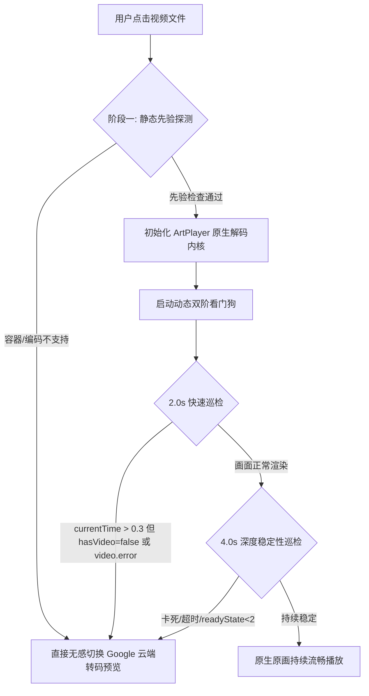

# 播放器交互架构、自适应降级状态机与零遮挡视窗使用手册 (Player Architecture & User Guide)

> 本文档面向全栈工程师、前端开发者、系统运维与高级用户，深入阐述 Cloudflare Drive Player 在流媒体解码兼容性检测、W3C HTML5 iframe 原生安全沙箱隔离以及极简沉浸式视窗架构的技术实现细节与使用指南。

---

## 目录
- [1. 背景与三大核心诉求](#1-背景与三大核心诉求)
- [2. 核心架构与技术实现原理](#2-核心架构与技术实现原理)
  - [2.1 双阶段智能自适应降级状态机](#21-双阶段智能自适应降级状态机)
  - [2.2 零遮挡 W3C 原生安全沙箱模型](#22-零遮挡-w3c-原生安全沙箱模型)
  - [2.3 极简 4 合 1 纯净控制台架构](#23-极简-4-合-1-纯净控制台架构)
- [3. 外部播放器调用协议白皮书 (URL Schemes)](#3-外部播放器调用协议白皮书-url-schemes)
- [4. 浏览器解码兼容性与自动选源矩阵](#4-浏览器解码兼容性与自动选源矩阵)
- [5. 质量验证与开发者调试指南](#5-质量验证与开发者调试指南)

---

## 1. 背景与三大核心诉求

在 Web 浏览器播放 Google Drive 媒体资源时，开发者和用户长期面临三个根本性的体验障碍：

1. **解码能力异构与操作割裂**：
   - 媒体文件常采用 MKV 封装，或包含 HEVC/H.265 10bit、DTS/AC-3 商业多声道音频。在不同平台（如 macOS/iOS Safari 不支持 MKV 封装、未装扩展的 Windows Chrome 仅能解码音频而黑屏）下，传统做法是弹出警告让用户手动点击切换，用户体验极差。
   - **改进目标**：**全自动无感降级**。由前端自动侦测环境；一旦环境不支持或起播卡死，自动切源至 Google 云端转码，告别手动排查。
2. **Google 预览右上角弹窗与遮罩层伪影**：
   - Google Drive Web Preview 页面右上角存在跳转按钮（Pop-out）。旧系统为了阻断该跳转，在视频右上角覆盖了一块半透明或透明的物理拦截 `div`，导致画面被遮挡、鼠标光标抖动，且影响全屏控制。
   - **改进目标**：**彻底移除物理遮罩层，保持 100% 画面纯净**；同时利用底层规范级安全沙箱与 CSP，静默阻断任何弹窗。
3. **播放器视窗拥挤与视觉噪声**：
   - 旧版 Header 堆砌了连播控制组、外挂字幕面板、下载按钮、直链按钮等大量元素，小屏极易折行。
   - **改进目标**：**极简 Header 四合一**：严格聚焦「① 文件名（自适应截断/全选）」、「② 调用本地播放器」、「③ 最大化/还原」、「④ 关闭」，紧随其后是开阔沉浸的播放画面。

---

## 2. 核心架构与技术实现原理

### 2.1 双阶段智能自适应降级状态机

系统引入了前置先验探测与动态运行时看门狗双阶段闭环：



#### 阶段一：静态先验探测 (`canBrowserPlayNatively`)

在向 DOM 插入 `<video>` 之前，解析媒体容器与名称元数据：
- **绝对黑名单容器**：`.avi`、`.wmv`、`.rmvb`、`.flv`、`.vob`、`.iso`。
- **Safari MKV 特异性阻断**：WebKit 引擎在 `document.createElement('video').canPlayType('video/x-matroska')` 返回空字符串，直接标记不支持。
- **商业多声道音频阻断**：文件名命中 `/(dts(-hd)?|truehd|atmos|ac3|eac3|ddp?5\.1)/i`，由于普通 Web 浏览器缺少杜比/DTS 商业专利授权，直接先验判定不通过。
- **HEVC / H.265 探测**：若包含 `/(hevc|h\.?265|x265)/i`，通过 `video.canPlayType('video/mp4; codecs="hvc1.1.6.L93.B0"')` 深入探测底层硬件加速；若不支持则判定失败。

**处理动作**：若静态探测失败，**跳过原生播放器初始化，毫秒级直接重定向至 `renderGooglePreview(item)`**。

#### 阶段二：动态双阶看门狗 (`startMediaWatchdog`)

针对 PC 端 Chrome 虽能打开 MKV 但仅有音频推进、屏幕全黑的特殊工况：
- **快速巡检 (2.0s)**：
  - 检查逻辑：`!video.paused && video.currentTime > 0.3 && !renderStatus.hasVideo`
  - 判定：音频已播放超过 0.3 秒，但画面帧渲染状态依然为 `false`（或触发 `video.error`）。
- **深度巡检 (4.0s)**：
  - 检查逻辑：视频未暂停，但进度为 0 且 `readyState < 2`（网络挂起或解码死锁）。

**处理动作**：看门狗捕获上述异常后，自动调用 `destroyPlayer()` 释放原生视频对象，立即无感平滑切换至 Google 云端转码通道起播，并弹出非阻断式状态 Toast 提示。

---

### 2.2 零遮挡 W3C 原生安全沙箱模型

为了满足用户“禁止右上角弹出遮挡，且绝不在画面右上角留下任何遮罩层”的严格要求，系统采用 W3C 原生沙箱规范重构：

```html
<iframe 
  id="google-drive-iframe"
  src="https://drive.google.com/file/d/{FILE_ID}/preview" 
  class="border-0 w-full h-full"
  style="position: absolute; top: 0; left: 0; width: 100%; height: 100%;"
  allow="accelerometer; autoplay; clipboard-write; encrypted-media; gyroscope; picture-in-picture; web-share; fullscreen"
  sandbox="allow-scripts allow-same-origin allow-forms allow-presentation"
  loading="eager"
></iframe>
```

#### 安全与纯净的机制保证：
1. **彻底物理废除**：完全删除以前覆盖在 iframe 之上的遮罩 `div`，视频区域全域具备原生光标与交互穿透。
2. **规范级弹窗阻断**：
   - 根据 [W3C HTML5 规范 (Section 4.8.5)](https://html.spec.whatwg.org/multipage/iframe-embed-element.html#attr-iframe-sandbox)，沙箱化 iframe 在**未显式声明 `allow-popups` 和 `allow-popups-to-escape-sandbox`** 时，任何通过 `window.open()`、`<a target="_blank">` 触发的新窗口创建请求，均会被浏览器底层引擎静默丢弃。
3. **防顶层重定向**：
   - 绝不授予 `allow-top-navigation` 或 `allow-top-navigation-by-user-activation`，防止跨域页面劫持宿主网站。
4. **CSP 双层加固**：
   - 在静态资源响应头 `public/_headers` 中配置：
     ```http
     Content-Security-Policy: frame-src 'self' https://drive.google.com; frame-ancestors 'self';
     ```
   - 严格限定仅允许嵌入 Google Drive 官方预览，杜绝任意第三方钓鱼风险。

---

### 2.3 极简 4 合 1 纯净控制台架构

顶部 Header 经过彻底精简，仅由 4 个原子组件构成：

```html
<div id="player-header" class="flex items-center justify-between px-3 sm:px-5 py-2 sm:py-2.5 border-b border-slate-800/80 bg-slate-900/95 select-none gap-2 sm:gap-3">
  <!-- 1. 文件名呈现器 (支持截断/Tooltip/全选) -->
  <div class="flex items-center gap-2 overflow-hidden min-w-0 flex-1">
    <i data-lucide="film" class="w-4 h-4 text-brand-500 flex-shrink-0" id="player-type-icon"></i>
    <span id="player-file-name" class="font-medium text-xs sm:text-sm text-slate-100 truncate select-all min-w-0" title="点击可全选完整文件名">正在播放...</span>
  </div>

  <!-- 功能按钮区 (核心三项) -->
  <div class="flex items-center justify-end gap-1.5 sm:gap-2 flex-shrink-0">
    <!-- 2. 本地播放器下拉 -->
    <div class="relative inline-block text-left" id="ext-player-dropdown-container">
      <button id="ext-player-menu-btn" class="...">调用本地播放器 ▾</button>
      <div id="ext-player-menu" class="hidden absolute right-0 mt-2 w-60 ...">...</div>
    </div>

    <!-- 3. 最大化/还原 -->
    <button id="player-maximize-btn" class="..." title="最大化窗口 (双击顶部栏也可最大化)">
      <i data-lucide="maximize-2" class="w-4 h-4" id="player-maximize-icon"></i>
    </button>

    <!-- 4. 关闭 -->
    <button id="close-player-btn" class="..." title="关闭 (Esc)">
      <i data-lucide="x" class="w-4 h-4"></i>
    </button>
  </div>
</div>
```

---

## 3. 外部播放器调用协议白皮书 (URL Schemes)

当用户希望享受本地 GPU 强力硬解、双语 ASS 特效字幕或家庭影院音响直通时，可通过「调用本地播放器」下拉菜单直接唤起客户端。

### 协议格式与示例

假定当前媒体文件的流媒体分片直链为：
```text
https://cf-pages-drive-player.pages.dev/api/stream/1ABC999VideoId?filename=Inception.2010.1080p.mkv
```
其 URL 编码串为：
```text
https%3A%2F%2Fcf-pages-drive-player.pages.dev%2Fapi%2Fstream%2F1ABC999VideoId%3Ffilename%3DInception.2010.1080p.mkv
```

#### 1. MPV (跨平台)
- **URL Scheme**：`mpv://<ENCODED_URL>`
- **触发链接**：
  ```text
  mpv://https%3A%2F%2Fcf-pages-drive-player.pages.dev%2Fapi%2Fstream%2F1ABC999VideoId%3Ffilename%3DInception.2010.1080p.mkv
  ```
- **终端一键命令**（点击下拉菜单中的「复制 MPV 终端命令」）：
  ```bash
  mpv "https://cf-pages-drive-player.pages.dev/api/stream/1ABC999VideoId?filename=Inception.2010.1080p.mkv"
  ```

#### 2. PotPlayer (Windows)
- **URL Scheme**：`potplayer://<ENCODED_URL>`
- **触发链接**：
  ```text
  potplayer://https%3A%2F%2Fcf-pages-drive-player.pages.dev%2Fapi%2Fstream%2F1ABC999VideoId%3Ffilename%3DInception.2010.1080p.mkv
  ```

#### 3. IINA (macOS)
- **URL Scheme**：`iina://weblink?url=<ENCODED_URL>`
- **触发链接**：
  ```text
  iina://weblink?url=https%3A%2F%2Fcf-pages-drive-player.pages.dev%2Fapi%2Fstream%2F1ABC999VideoId%3Ffilename%3DInception.2010.1080p.mkv
  ```

#### 4. VLC Media Player (全平台 / 移动端)
- **URL Scheme**：`vlc://<ENCODED_URL>`
- **触发链接**：
  ```text
  vlc://https%3A%2F%2Fcf-pages-drive-player.pages.dev%2Fapi%2Fstream%2F1ABC999VideoId%3Ffilename%3DInception.2010.1080p.mkv
  ```

#### 5. Infuse (iOS / macOS / Apple TV)
- **URL Scheme**：`infuse://x-callback-url/play?url=<ENCODED_URL>`
- **触发链接**：
  ```text
  infuse://x-callback-url/play?url=https%3A%2F%2Fcf-pages-drive-player.pages.dev%2Fapi%2Fstream%2F1ABC999VideoId%3Ffilename%3DInception.2010.1080p.mkv
  ```

#### 6. Android ExoPlayer (系统级 Intent)
- **协议格式**：
  ```text
  intent:<RAW_STREAM_URL>#Intent;type=video/*;end
  ```

---

## 4. 浏览器解码兼容性与自动选源矩阵

| 媒体格式 / 编码组合 | Chrome / Edge | Safari (macOS / iOS) | Firefox | 移动端 Chrome/Safari | 系统自动处理行为 |
| :--- | :---: | :---: | :---: | :---: | :--- |
| **MP4 (H.264 + AAC)** | 原生硬解 | 原生硬解 | 原生硬解 | 原生硬解 | **原生 Artplayer 秒开**，支持 206 进度拖拽 |
| **WebM (VP9 + Opus)** | 原生硬解 | 部分支持 (Safari 14.1+) | 原生硬解 | 原生硬解 | **原生 Artplayer 秒开** |
| **MKV (AVC / H.264 + AAC)** | 原生播放 | ❌ 不支持封装 | 原生播放 | ❌ 部分不支持 | Safari **自动先验切换 Google 云端转码**；Chrome 原生播放 |
| **MKV (HEVC / H.265 10bit)**| 视硬解扩展而定 | ❌ 不支持封装 | 视系统硬解而定 | 视芯片硬解而定 | 若无硬解或看门狗检测黑屏，**2.0s 内无感切至转码** |
| **MKV (DTS / TrueHD / AC-3)**| ❌ 仅有画面无声音 | ❌ 不支持封装 | ❌ 无商业授权 | ❌ 无商业授权 | **阶段一静态探测命中，直接切源至云端转码** |
| **AVI / WMV / RMVB / ISO** | ❌ 不支持封装 | ❌ 不支持封装 | ❌ 不支持封装 | ❌ 不支持封装 | **阶段一静态拦截，直接调用云端转码或本地播放器** |

---

## 5. 质量验证与开发者调试指南

### 5.1 自动化质量检查 (CI-Check)

在提交代码或合并发布前，运行静态语法与契约校验：

```bash
node scripts/ci-check.js
```

**预期输出验证**：
```text
🚀 [CI-Check] 开始执行全栈工程交付 CI/CD 自动化质量闸门检查...

🔍 [步骤 1/7] 执行 JavaScript 语法与 AST 原生解析校验...
✅ 已通过 11 个 JavaScript 文件的 AST 语法完整性验证 (0 错误)。

🔍 [步骤 2/7] 验证 public 静态资源完整性与 _routes.json 边缘路由隔离...
✅ 静态文件有效: \public\index.html
✅ 静态文件有效: \public\css\style.css
✅ 静态文件有效: \public\js\app.js
✅ 静态文件有效: \public\favicon.svg
✅ 静态文件有效: \public\_routes.json
✅ 静态文件有效: \public\_headers
✅ _routes.json 边缘路由隔离规则符合标准 (静态资源直通 CDN，计算与静态物理隔离)。

🔍 [步骤 3/7] 验证 wrangler.toml 部署配置合规性...
✅ wrangler.toml 配置合规 (pages_build_output_dir = "public")。

🔍 [步骤 4/7] 校验流媒体 API 路由契约与 MKV/MP4 Range 分片穿透支持...
✅ 流媒体服务契约全部合规 (支持 MKV MIME 规范化、HTTP 206 Range 分片与 CORS 标头暴露)。

🔍 [步骤 5/7] 校验【需求 2】Google 预览零遮挡安全沙箱模型与防弹窗门禁...
✅ 零遮挡反退化门禁通过：已彻底移除右上角及全域遮罩拦截层，视频视窗 100% 纯净无遮挡。
✅ Google 预览原生沙箱合规：sandbox="allow-scripts allow-same-origin allow-forms allow-presentation" (成功阻断 allow-popups 与 top-navigation)。

🔍 [步骤 6/7] 校验【需求 1】客户端双阶自适应降级播放与智能选源契约...
✅ 阶段一静态先验探测契约就绪：覆盖 MKV 容器、Safari/WebKit 兼容性与 HEVC/多声道音频。
✅ 阶段二动态看门狗与智能自动降级契约就绪：起播黑屏/卡死自动无感切换至云端转码预览。

🔍 [步骤 7/7] 校验【需求 3】极简播放器 Header 结构与边缘安全响应头...
✅ 播放器顶部 Header 核心四项控件完整齐备 (文件名 / 本地播放器 / 最大化 / 关闭)。
✅ 播放器顶部 Header 视觉精简验证通过：无多余静态徽章与堆叠按钮，界面极简纯净。
✅ 边缘响应头安全合规：CSP 明确放行 drive.google.com，且配置严格 MIME 防嗅探与 CORS 标头。

🎉 [CI-Check 质量闸门] 全部 7 个自动化阶段静态检查与安全门禁均 100% 通过！
```

### 5.2 浏览器端功能人工核验步骤 (Manual Verification Steps)

1. **自动降级验证**：
   - 准备一个 `.avi` 或带 `DTS` 音轨的文件，在网页中点击播放。
   - **验证点**：控制台不应报错，视窗应直接渲染 `google-preview-container` 并开始缓冲播放，不应出现原画播放器黑屏或黄色手动警告条。
2. **右上角零遮挡与弹窗拦截验证**：
   - 切换至 Google 预览模式。
   - **验证点**：使用 Chrome DevTools 审查元素，确认 `#google-preview-container` 内没有任何透明遮罩 `div`；点击 Google 播放器画面右上角区域，鼠标样式自然，且不会在浏览器新标签页弹出 Google Drive 界面。
3. **极简 Header 验证**：
   - 检查播放器顶部栏。
   - **验证点**：仅出现文件名、本地播放器按钮、最大化按钮、关闭按钮 4 项；长文件名应展示省略号且点击可全选；点击本地播放器下拉展示 6 种播放器及命令。
